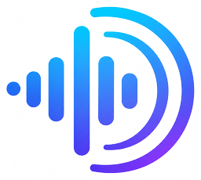
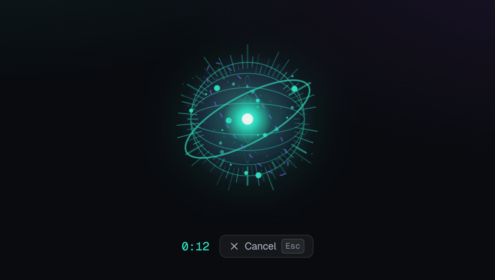
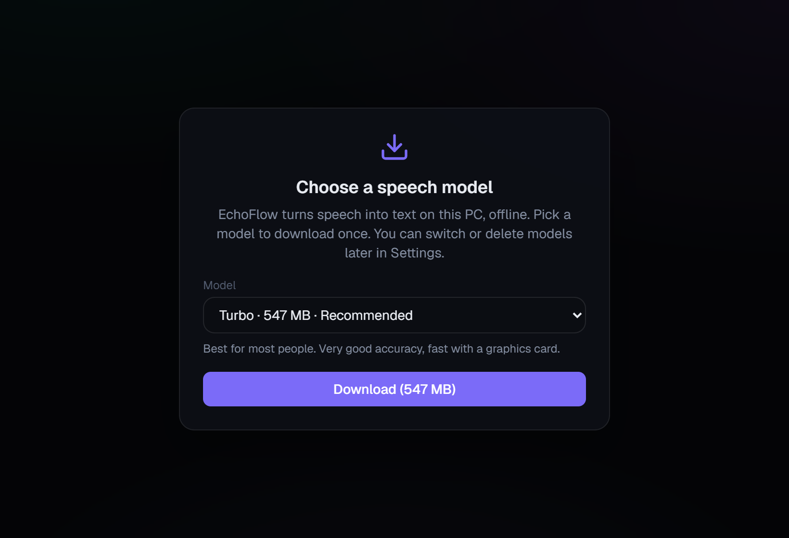
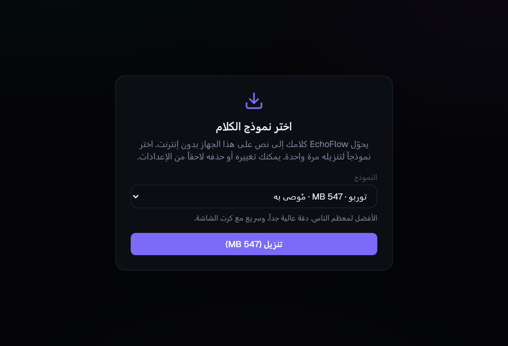
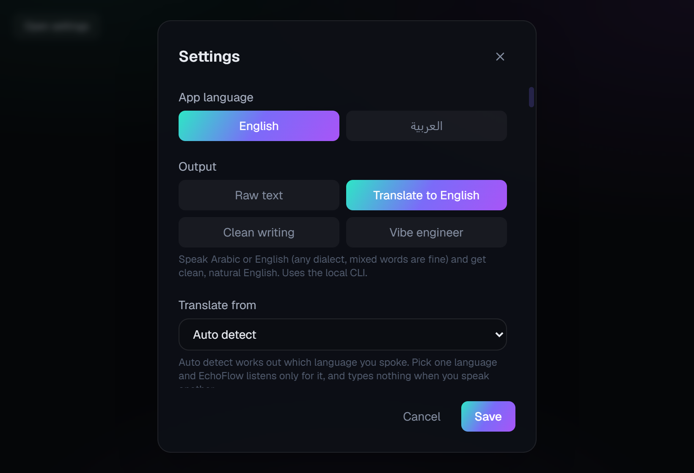
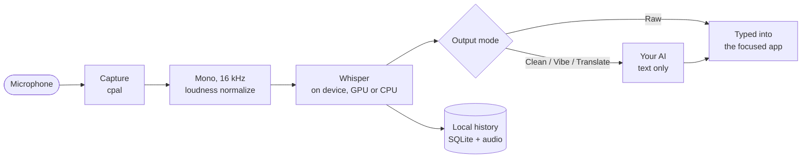

<div align="center">



# EchoFlow

**Speak. It types. Your voice never leaves your PC.**

Free, offline voice to text for Windows, in English and Arabic.
Press a hotkey, talk, press it again, and your words are typed into whatever app you are in.

<p>
  <a href="https://github.com/Mnourkh01/echoflow-releases/releases/latest"></a>
  
  
  
</p>

<a href="https://github.com/Mnourkh01/echoflow-releases/releases/latest"></a>

<br /><br />



</div>

---

## Why EchoFlow

Most dictation tools send your voice to a server, charge a monthly fee, and struggle with Arabic. EchoFlow does the opposite.

- **Private by design.** Speech is turned into text on your own machine with [Whisper](https://github.com/ggerganov/whisper.cpp). No account, no subscription, and your audio is never uploaded.
- **Arabic as people speak it.** Recognition is primed for Egyptian, Levantine, Gulf, Iraqi and Maghrebi Arabic instead of forcing formal Arabic, and mixed Arabic and English in one sentence is fine.
- **Works everywhere you type.** Email, chat, your editor, a terminal, a browser field. The text is pasted at your cursor; if the app you were in cannot get focus back, it is left on the clipboard instead.
- **Fast.** The published installers run Whisper on your graphics card (Vulkan) and fall back to the CPU automatically when there is none.

## Features

| | |
|---|---|
| **One hotkey, anywhere** | Press `Ctrl` + `Shift` + `Space` in any app to start, and again to stop. Prefer push to talk? Switch to hold mode in Settings. Inside the app, hold `Space`. `Esc` cancels a take. |
| **Four output modes** | **Raw text** (fully offline), **Clean writing** (fixes grammar and filler words), **Vibe engineer** (rewrites rough dev talk in clear engineering language, without adding scope) and **Translate to English**. Switch from the header or the tray icon. |
| **Languages** | English, Arabic and its dialects, French, German, Spanish, Italian, Portuguese and Dutch, with accents and diacritics kept. Auto-detect, or lock English or Arabic so Clean writing and Vibe engineer translate stray words into it. |
| **Custom vocabulary** | Teach it names and terms it should never get wrong. |
| **History** | Every take is saved locally and searchable. Pin the ones you want, export to `.txt`, `.srt` or `.docx`, and set how long recordings are kept. |
| **Floating pill** | Shrink the window to a small always-on-top pill and keep dictating. `Ctrl` + `Shift` + `E` flips between the two. |
| **Quiet speech** | Loudness normalization is always on, so quiet speech is picked up (a take with almost no sound is discarded). Noise suppression is one switch away for loud rooms. |
| **Right to left** | Arabic transcripts render RTL with an Arabic font, and the whole interface is available in Arabic. |
| **Updates itself** | Signed updates are downloaded and applied in place with one click. |

## A look inside

<table>
  <tr>
    <td width="50%"></td>
    <td width="50%"></td>
  </tr>
  <tr>
    <td align="center"><sub>First run: pick one speech model and download it once</sub></td>
    <td align="center"><sub>The whole interface is available in Arabic</sub></td>
  </tr>
  <tr>
    <td colspan="2" align="center"></td>
  </tr>
  <tr>
    <td colspan="2" align="center"><sub>Settings: output mode, languages, hotkeys, models and more</sub></td>
  </tr>
</table>

## Get started

1. Download the installer from the [releases page](https://github.com/Mnourkh01/echoflow-releases/releases/latest) and run it.
2. On first launch, pick a speech model. **Turbo (547 MB)** is the recommended choice; smaller models are lighter, bigger ones hear accents and dialects better.
3. Click into any text field, press `Ctrl` + `Shift` + `Space`, speak, and press it again.

That is the whole setup. Raw transcription never needs the internet after the model download.

## Privacy

- **Speech recognition is always local.** Your audio and your history stay in the app's folder on your PC.
- **The AI modes are opt-in.** Clean writing, Vibe engineer and Translate send the *text* you dictated (never the audio) to the AI you choose: the `claude` CLI on the subscription you already have, or your own API key (Anthropic, OpenAI or a custom endpoint).
- **Raw mode never sends your speech or text anywhere.** The app goes online only to check for updates and to download the speech model you pick.
- **You decide how long recordings are kept.** By default, recordings older than 14 days are deleted; change it in Settings or keep them forever.

## How it works



| Layer | Built with |
|---|---|
| App shell | Tauri 2, Rust |
| Speech | whisper.cpp through `whisper-rs`, GGML models, Vulkan GPU build with CPU fallback |
| Audio | `cpal` capture, custom anti-aliased resampling to 16 kHz mono |
| Interface | React 18, TypeScript, Vite, Tailwind |
| Storage | SQLite (`rusqlite`), audio files on disk |
| Export | `.txt`, `.srt`, `.docx` (`docx-rs`) |

## Build from source

Requirements:

- Windows with Microsoft C++ Build Tools (MSVC)
- [Rust](https://rustup.rs) (stable, MSVC host) and CMake
- LLVM/libclang for the `whisper-rs` bindings: set `LIBCLANG_PATH` to its folder, or the build fails with "Unable to find libclang"
- `CMAKE_GENERATOR` set to your installed Visual Studio generator (for example `Visual Studio 16 2019`), or CMake aborts
- Node.js 18+

```bash
npm install
npm run tauri dev      # development with hot reload
npm run tauri build    # CPU release bundle
```

On first run you choose which Whisper GGML model to download; it lands in app-data and is kept across updates. Settings can download more, switch, and delete any model not in use. For local engine tests, drop `ggml-small.bin` (and `jfk.wav`) into `src-tauri/models/`:

```bash
curl -L -o src-tauri/models/ggml-small.bin \
  https://huggingface.co/ggerganov/whisper.cpp/resolve/main/ggml-small.bin
cd src-tauri && cargo test
```

Plain `cargo build` and `cargo test` use the CPU and need no GPU SDK. The published installers are built with `npm run tauri build -- --features gpu-vulkan`, which also needs the Vulkan SDK (`VULKAN_SDK` set and `glslc` on `PATH`).

## Credits

Speech recognition by [whisper.cpp](https://github.com/ggerganov/whisper.cpp) and OpenAI's Whisper models. Built by [Mohammad Nour](https://github.com/Mnourkh01).
